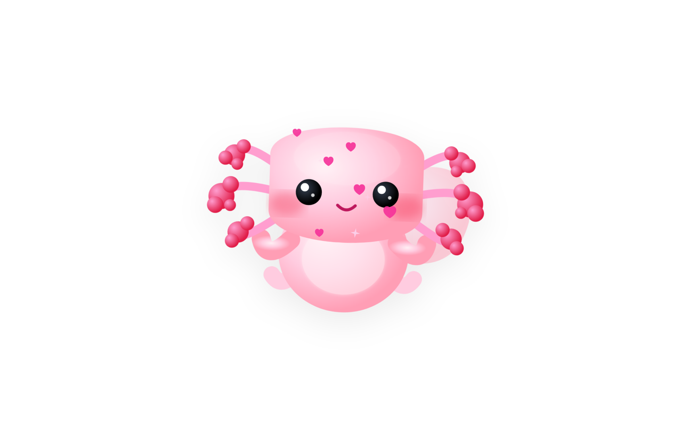

<div align="center">

# Interactive Axolotl Pet

Axo, a pink axolotl that blinks, follows your pointer and hops with hearts and sparkles when you click it.

[Live page](https://gitguy268.github.io/interactive-axolotl-pet/) · [Vercel mirror](https://gitguy268-interactive-axolotl-pet.vercel.app/) · [Run it locally](#run-it-locally) · [Embed it](#embed-it) · [How it works](#how-it-works) · [Contributing](#contributing)

   



</div>

## What it does

- **Watches you:** the head, face and eyes follow the pointer, and the gills trail behind with a little lag.
- **Blinks** every few seconds at a random interval.
- **Reacts to clicks:** a short hop, a blink, six floating hearts and three sparkles.
- **Transparent background,** so it can sit on top of any page.

## Run it locally

You need Node.js 20 or newer.

```sh
git clone https://github.com/Gitguy268/interactive-axolotl-pet.git
cd interactive-axolotl-pet
npm ci
npm run dev          # http://localhost:5173
```

`npm run build` writes one self-contained file, `dist/index.html` (about 240 kB, 74 kB gzipped), with the script and styles inlined. You can open it by double-clicking.

`indexe.html` is a separate standalone version in plain HTML, CSS and JavaScript, without React.

## Embed it

Copy `src/components/Axolotl.tsx`, `src/utils/cn.ts` and the keyframes in `src/index.css` into a React project with Tailwind CSS 4, then:

```tsx
import { Axolotl } from "./components/Axolotl";

<Axolotl size={320} />
```

`size` takes a number of pixels (default 420) or any CSS width. `className` is passed to the outer element.

<details>
<summary>How it works</summary>

- The axolotl is drawn with nested `div`s, gradients and box shadows. There are no images.
- One `requestAnimationFrame` loop eases the pose toward the pointer (linear interpolation, factor 0.12). State only updates when the pose moves noticeably, which keeps React re-renders low.
- Hearts and sparkles are short-lived particles, removed 1.4 s after each click. Their positions are fixed per index, so a burst looks the same each time.
- The animations (`heart-float`, `sparkle-pop`, `hop`) are CSS keyframes in `src/index.css`.

</details>

## Contributing

Ideas and fixes are welcome. See [CONTRIBUTING.md](CONTRIBUTING.md) and the [Code of Conduct](CODE_OF_CONDUCT.md).

## License

[MIT](LICENSE). Dependencies are listed in [NOTICE](NOTICE).
